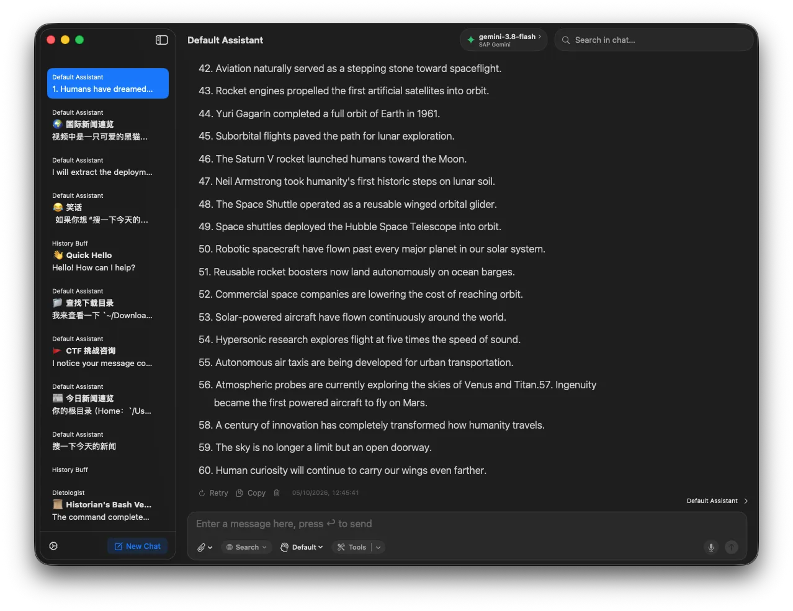
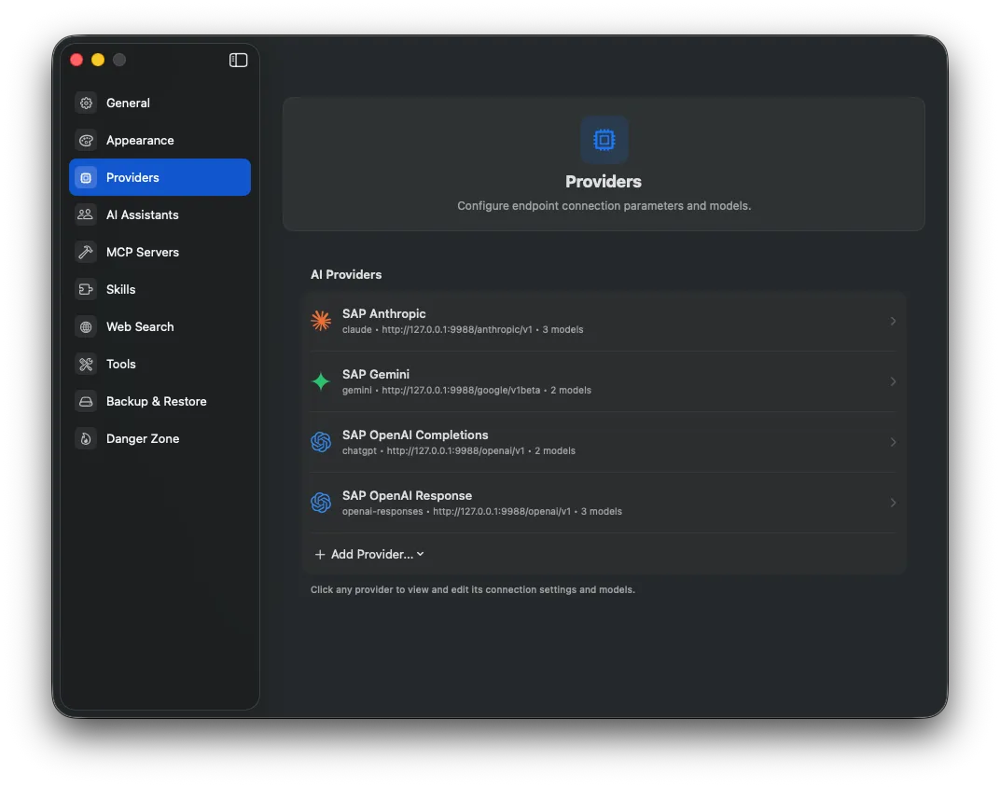
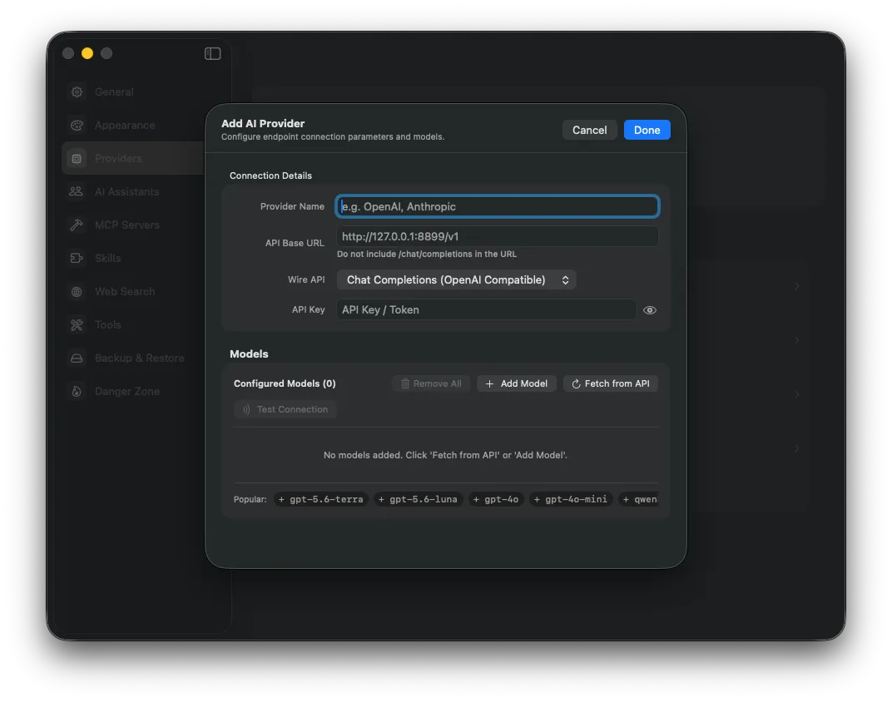

<div align="center">
  
</div>
<h2 align="center">Chatmice</h2>

<a href="#"></a> <a href="#"></a> <a href="https://github.com/xeric/Chatmice/actions/workflows/swift-xcode.yml"></a> <a href="https://github.com/xeric/Chatmice/blob/main/LICENSE.md"></a>
<a href="https://github.com/xeric/Chatmice/releases/latest"></a>

Chatmice is a simple yet powerful native macOS AI chat client that supports most AI providers: ChatGPT, Claude, xAI (Grok), Google Gemini, Perplexity, Ollama, OpenRouter, and almost any OpenAI-compatible APIs.

## Screenshots

<p align="center">
  
</p>

<p align="center">
  
</p>

## Table of Contents
- [Screenshots](#screenshots)
- [Downloads](#downloads)
  - [Manual](#manual)
- [Contributions](#contributions)
- [Why Chatmice](#why-chatmice)
- [Workspaces](#workspaces)
- [Run with ChatGPT, Claude, xAI or Google Gemini](#run-with-chatgpt-claude-xai-or-google-gemini)
- [Run with Ollama](#run-with-ollama)
- [System requirements](#system-requirements)
- [Project status](#project-status)
- [Build from source](#build-from-source)
- [iCloud Sync Configuration](#icloud-sync-configuration)
- [License](#license)

## Downloads

Download builds from the [Chatmice releases page](https://github.com/xeric/Chatmice/releases). Until the first signed release is published, build the app from source using the instructions below.


## Contributions
Contributions are welcome. Check the [Chatmice issues](https://github.com/xeric/Chatmice/issues) before opening a new issue or pull request.

Chatmice is derived from [macai](https://github.com/Renset/macai), created by Renat Notfullin and its contributors. Chatmice retains the upstream Apache-2.0 license and attribution while developing an independent product direction.


## Why Chatmice
- **macOS-native and lightweight**
- **User-friendly**: simple setup, minimalist light/dark UI
- **Feature-rich**: vision, image generation, search, reasoning, import/export and more
- **iCloud Sync**: keep chats, messages, and settings in sync across devices
- **Workspace-aware**: group chats by project, keep local tools inside a selected folder, and reference files with `@`
- **Private and secure**: no telemetry or usage tracking by Chatmice (Note: Apple may collect anonymized telemetry when iCloud Sync is enabled)
- **Native Markdown rendering**: selectable rich text and code use AppKit TextKit; SwiftMath formulas use their native fitting size. Message layout uses measured heights rather than lazy estimates, keeping the latest turn visible when sending or retrying below long content, from waiting for the first token through streaming growth and completion. Scrolling away pauses bottom-following; reaching the bottom or sending another request resumes it. Completing a response does not move a reader who has scrolled away.
  Assistant content fills the available message column up to 720 points. TextKit measurement probes do not replace the final drawing width, so stopping a window resize does not leave long paragraphs or numbered lists wrapped into a narrow column.
- **Persistent message actions**: completed messages keep their action bar and timestamp visible at 50% opacity. Hovering over the message or action bar restores full opacity.
- **Window appearance**: **Settings → Appearance → Background Opacity / Blur** controls the window background. The workspace sidebar extends to the top of the window, retaining native window controls, its system toggle, and bottom actions. The conversation title, model picker, search, and file-panel toggle belong to a separate 52-point header inside the main content column; the file inspector owns its full-height right column. Use **⌘S** to toggle the sidebar and drag its divider to resize it.
  The file inspector uses its native boundary and panel background, matching the workspace sidebar without an additional separator or material overlay.
  Model selection and chat search are 36 points high and use capsule-shaped Liquid Glass backgrounds on macOS 26 and later, with translucent capsule borders on earlier macOS versions. The file-panel toggle uses a circular Liquid Glass button; when the inspector opens, the toggle moves to its top-right header above the workspace title and file content.
  The model picker sizes to its model name and expands leftward while remaining next to chat search.
  A single shared behind-window frosted-glass background uses AppKit's under-window material at full effect opacity, without a second material layer on the main content. Appearance settings adjust its tint rather than exposing an unblurred background by fading the visual-effect view. The inspector-header toggle is the only file-panel close control; the file-tree title retains its refresh action.
  The main-content header uses within-window frosted material with a 44-point fade into the conversation below and a 48-point fade-in at its left edge to avoid an abrupt material seam beside the sidebar. This visual overlay does not intercept clicks or scrolling and does not extend into the side panels.


## Workspaces

Use the chevron beside **New Chat** to create a workspace and choose its required local folder. The sidebar groups chats by workspace; click a workspace title or its chevron to expand and collapse its chats, drag the title to reorder workspaces, or use the `+` button to start a chat there. The main conversation header shows the workspace path beneath the conversation title; sidebar chat rows do not show paths. File tools, Bash working directories, and Python execution are restricted to that workspace folder.

When reordering workspaces or draggable settings lists, a rounded dashed **Drop here** placeholder marks the insertion position. The source item fades to 60% opacity while the drag preview keeps its original size and 100% opacity. Drop on the indicated position to reorder; leaving the list or pressing **Esc** removes the hint without changing the order. The source returns to full opacity when the drag ends, including cancellation or release outside the window.

Bash and Python commands run in a macOS sandbox. Workspace data access is limited to the selected folder, and Python network access is denied. A non-zero exit or watchdog timeout is reported to the model as a failed tool call instead of a successful result.

Type `@` in the message box to search for and insert a relative file or directory reference from the current workspace. Keep typing to filter (including Chinese names), use **↑/↓** to change the highlighted candidate, and press **Return** to insert it rather than send the message. Clicking a candidate does the same; the caret stays after the complete reference and its separating space. Inserted references are edited as a unit: arrow keys skip their path and Backspace removes the complete reference. **Esc** dismisses the candidate list; Return then sends normally. **New Chat** and **⌘N** follow the selected chat's workspace; with no chat selected, they use **Temporary Chats** at `/tmp/chatmice`. Each workspace's `+` always creates a chat in that group. Creating a chat expands its workspace, selects the new chat in the sidebar, and displays it on the right, even if that workspace was collapsed.

Drag a file or directory from the workspace file tree onto the message input, or choose **Reference in Message** from its context menu, to insert the same atomic `@` reference. The whole input rectangle, including its toolbar and padding, accepts reference drops and highlights its rounded border in the accent color while targeted. Directory references end in `/`; references are restricted to the current workspace and inserted only into the originating window. Existing file attachment drops remain separate.

Temporary Chats does not display its internal folder path and disables the workspace file-browser button. Switching to a regular workspace makes the file browser available again.

The conversation header uses one continuous material layer above the message content and below the header controls. Its opacity fades down through the header into the content; the message background cannot cover the fading portion, and controls remain crisp and interactive.

The `@` candidate list rescans the workspace each time it opens and watches recursive filesystem changes while visible, so newly created, renamed, and deleted files are reflected without restarting the app. Changing the workspace folder cancels the old listing and loads the new folder. Hidden files, symlinks, and package contents remain excluded from suggestions.

Use the native toolbar's right-sidebar button to show or hide the current workspace's file browser. The full-height macOS inspector has its own toolbar section: chat search stays to the left of its divider, while the inspector button stays at the window's trailing edge in both states. Drag the divider to resize it (220–360 points; initially 260); macOS restores the chosen width. The native AppKit outline loads each directory when expanded, includes hidden files, and updates loaded directories on filesystem changes while preserving expansion and selection. Symlinks and application packages are shown as leaves rather than traversed. Double-click a folder to expand or collapse it; double-click a file or press **Space** for Quick Look, or press **Return** to open it. The context menu also offers **Reveal in Finder** and **Copy Relative Path**. The panel follows workspace changes and its header provides refresh and close buttons. No additional package is required.

Use a workspace's **… → Edit…** menu to change its name or folder. Changing the folder affects subsequent tool requests in all its chats; it does not move files. **Delete…** asks for confirmation and permanently deletes every chat in that workspace while leaving its local folder and files untouched. Temporary Chats cannot be edited or deleted, and active conversations must finish or be stopped before their workspace can be changed.

The global **Enable File Tool** switch controls availability, not selection. New chats inherit **Default Tool List**, and each chat can override it in the input toolbar's **Tools** menu. File Tool must be enabled in both layers. When selected, the agent is instructed to use `read_file`, `write_file`, `edit_file`, `list_directory`, and `sql_query` for supported file operations rather than equivalent shell commands. Code Execution remains available for builds, Git, other command-line programs, and computation.

## Run with ChatGPT, Claude, xAI or Google Gemini
To run Chatmice with ChatGPT or Claude, you need an API token. Treat API tokens like passwords. Most commercial providers offer trial credits for new accounts.
Here is how to get API token for all supported services:
- OpenAI: https://help.openai.com/en/articles/4936850-where-do-i-find-my-secret-api-key
- Claude: https://docs.anthropic.com/en/api/getting-started
- Google Gemini: https://ai.google.dev/gemini-api/docs/api-key
- xAI Grok: https://docs.x.ai/docs#models
- OpenRouter: https://openrouter.ai/docs/api-reference/authentication#using-an-api-key

If you are new to LLM and don't want to pay for the tokens, take a look Ollama. It supports dozens of OpenSource LLM models that can run locally on Apple M1/M2/M3/M4 Macs.

## Run with [Ollama](https://ollama.com)
Ollama is the open-source back-end for various LLM models. 
Run Chatmice with Ollama:
1. Install Ollama from the [official website](https://ollama.com)
2. Follow installation guides
3. After installation, select model (llama3.1 or llama3.2 are recommended) and pull model using command in terminal: `ollama pull <model>`
4. Open **Settings → Providers**, choose **Add Provider**, then enter Ollama's OpenAI-compatible endpoint (by default `http://127.0.0.1:11434/v1`):

   

5. Select model, and default AI Assistant and save
6. Test and enjoy!

## System requirements
macOS 15.0 and later (both Intel and Apple chips are supported)

## Project status
Project is in the active development phase.

### Build from source

#### Option 1: With Apple Developer Account (Full Features)

If you have an Apple Developer account and want to build with iCloud Sync support:

1. Clone the repository: `git clone https://github.com/xeric/Chatmice.git`
2. Open `Chatmice.xcodeproj` in Xcode
3. Select your team in Signing & Capabilities
4. *(Optional)* To enable iCloud Sync in Debug builds, remove `DISABLE_ICLOUD` from Build Settings → Swift Compiler → Active Compilation Conditions
5. Build and run

> **Note:** By default, Debug builds have iCloud Sync disabled via the `DISABLE_ICLOUD` flag to simplify contributor setup. Release builds have iCloud Sync enabled.

#### Option 2: Without Apple Developer Account (No iCloud Sync)

If you don't have an Apple Developer account, you can still build and run the app without iCloud Sync:

**Using Xcode:**
1. Clone the repository: `git clone https://github.com/xeric/Chatmice.git`
2. Open `Chatmice.xcodeproj` in Xcode
3. Select the `Chatmice` target → Build Settings tab
4. Search for `CODE_SIGN_ENTITLEMENTS`
5. Change the value from `Chatmice/Chatmice.entitlements` to `Chatmice/Chatmice-no-icloud.entitlements`
6. In Signing & Capabilities, set "Signing Certificate" to "Sign to Run Locally"
7. Build and run

**Using Command Line:**
```bash
git clone https://github.com/xeric/Chatmice.git
cd Chatmice
xcodebuild -scheme Chatmice \
  -configuration Debug \
  CODE_SIGN_IDENTITY="-" \
  CODE_SIGN_ENTITLEMENTS="Chatmice/Chatmice-no-icloud.entitlements" \
  DEVELOPMENT_TEAM="" \
  CODE_SIGNING_ALLOWED=NO \
  build
```

> **Note:** The app built without iCloud entitlements will work normally, but the iCloud Sync feature will not be available. All other features (chat, API services, personas, etc.) will work as expected.

### iCloud Sync Configuration

#### For Contributors (Debug Builds)

iCloud Sync is **disabled by default** in Debug builds via the `DISABLE_ICLOUD` compiler flag. This simplifies the development setup and avoids CloudKit-related signing issues for contributors without an Apple Developer account.

**To enable iCloud Sync in Debug builds:**
1. Select the `Chatmice` target → Build Settings tab
2. Search for `SWIFT_ACTIVE_COMPILATION_CONDITIONS` (or "Active Compilation Conditions")
3. Remove `DISABLE_ICLOUD` from the value (leaving just `DEBUG`)
4. Ensure you have proper entitlements and signing configured (see below)

#### For Custom Builds

If you want iCloud Sync to work in a custom build, you must use your own CloudKit container:

1. Create a CloudKit container in your Apple Developer account
2. Enable the iCloud capability for the Chatmice target in Xcode, and add your container
3. Update the `CloudKitContainerIdentifier` value in `Chatmice/Info.plist` to your container ID
4. Ensure your app's bundle identifier matches the one you registered for the container
5. Remove `DISABLE_ICLOUD` from Active Compilation Conditions if present

If `CloudKitContainerIdentifier` is missing, the app falls back to the default container.

## License
[Apache-2.0](https://github.com/xeric/Chatmice/blob/main/LICENSE.md). Chatmice is derived from [macai](https://github.com/Renset/macai); original copyright and attribution notices are retained.
